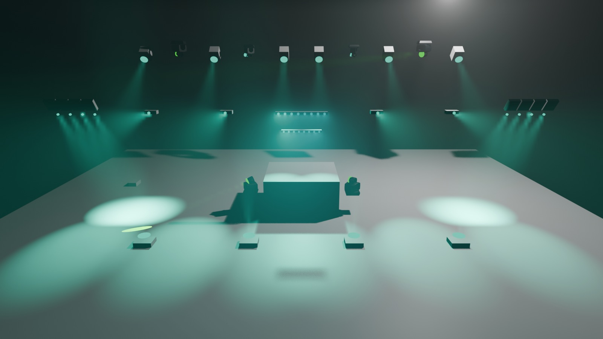
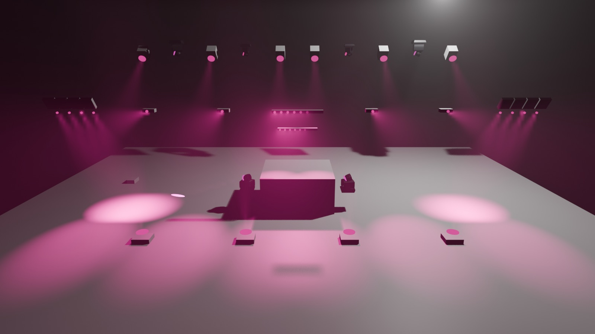

# Lighting review, 2026-10-21

## Scope and 3D capture

The three generated workspaces were rebuilt from their descriptions and loaded by QLC+ 5.2.2. The checker covers console reachability, fixture capabilities, smoke pump ownership, flash channels, colour ownership, movement coverage, and concurrent movement clocks. The tablet map is generated from the same workspace as the operator console.

For a visual check, an isolated QLC+ instance played the `Fiesta` AUTO state from a workspace copy with input, output, and feedback patches removed. Its DMX vectors were applied to the current stage MVR in BlenderDMX. The images below are frame captures, not photographs of the venue:

| Previous independent rotations | Shared figure clock |
| --- | --- |
|  |  |

The previous `Movimientos Cabezas` Collection started a random wash rotation and a random beam rotation together. Their independent step clocks selected unrelated figures. The rebuilt Collection starts one ordered Chaser; each step starts the matching wash and beam figure together. The eighth step pairs the wash circle with `Cascada Beams`. Both optics families now use the same 16 second EFX duration value and 5 second transition; QLC+ subtracts the transition from the effective figure loop. The generator retains the separate family sizes and the measured audience windows.

The captures confirm the patch, colour output and symmetric fixture positions in the model. The preview does not reproduce every physical beam sharply enough to settle aim, glare or the travelling cascade. Judge those from the room before changing the measured windows.

## White flash runtime probe

`Flash 100%` writes the white wheel slot (`4`) to all four 7R heads and `255` to the RGBW channels of both MAC heads. Its QLC+ button requests Override and ForceLTP. The static scene and semantic checks therefore describe white on those fixtures.

With AUTO running in the isolated QLC+ instance, a held flash was sampled 80 times at roughly 200 ms intervals. In one run, two single API reads briefly differed from white: the 7R wheels showed their AUTO value once, and the MAC RGBW channels showed an AUTO colour once. In a second run using three reads per sample and the median, one sample showed MAC RGBW at zero. The next samples returned to white. Those web-channel reads alone could not establish what reached an output.

An independent Art-Net capture on 2026-10-21 settled the QLC+ output distinction. A temporary copy of `Vibra.qxw` had all saved inputs, outputs and feedback removed, then one output added with `Plugin="ArtNet" UID="127.0.0.1" Line="0"`. A UDP receiver on loopback port 6454 decoded ArtDmx packets. The operator's QLC+ process on port 9998 and every physical output were untouched. AUTO ran throughout each trial:

| Trigger | Steady Art-Net frames | 7R colour wheels | MAC RGBW |
| --- | ---: | ---: | ---: |
| Console Flash button 12, `12|255` | 794 | 0 non-white | 0 non-white |
| Tablet Flash burst button 574, `574|255` | 302 | 299 non-white | 0 non-white |
| Tablet burst with `Override="1" ForceLTP="1"` added to its Toggle action | 300 | 298 non-white | 0 non-white |

The four 7R wheel channels were expected to hold white slot `4`; the two MAC heads' 24 RGBW channels were expected to hold `255`. Startup, the first 750 ms after triggering and release were excluded from these steady counts. The tablet burst is a SingleShot Chaser whose private Scene has the same values as `Flash 100%`, but a Toggle starts it with ordinary priority. Later AUTO colour steps reclaim the LTP wheel channels. The actual console Flash button uses Override and ForceLTP, so it holds white. QLC+'s Toggle path ignores those attributes; marking a Chaser button Flash did not run the burst in a separate trial.

A disconnected-client test also matters: after pressing the console Flash button, closing its WebSocket left white output active for 490 further Art-Net frames. Giving the tablet that button and relying only on its eight-second timer would therefore risk a stuck full-output flash when the link fails. Setting the Scene's Duration to 8000 ms and calling `setFunctionStatus|2|0` did not release it. A safe replacement needs both priority and an expiry owned by the controller host; the current tablet burst retains its bounded expiry but cannot guarantee white on the 7R. The USB-DMX wire and fixtures are still unmeasured.

The controller extension now reads `MaxHold` on Flash buttons, releases them from QLC+ itself, and reports `flashMaxHoldMs`, `flashOverride` and `flashForceLTP` in `/vc.json`. All 25 tablet hit sources carry Override, ForceLTP and their own duration; the desk checks the live controller values before enabling a hit. The dated generator regression removes each of those three attributes from every hit in turn and requires a finding. All three show descriptions regenerated byte-identically, passed `qlctool check`, and loaded in the modified QLC+ 5.2.2 build. In a new isolated loopback Art-Net run with Fiesta active, all four 7R colour wheels stayed at white slot `4` for 92/92 steady frames from the priority Flash. After the WebSocket closed, 650/894 subsequent frames had resumed a non-white wheel value as the controller deadline expired. The automated Art-Net regression captures the same held and disconnected phases. Physical FT232R output and fixture response still require measurement at the rig.

## Follow-up at the rig

The Mac mini now runs the tagged `v5.2.2-vibra.1` QLC+ binary against the regenerated `Vibra.qxw`. The USB-connected tablet booted image v96 with dmxdesk v0.1.9; its executable and map hashes match the build, and its log reports a linked controller with the show controls enabled. Fiesta was restored after restarting QLC+. The C host suite passed its 32-view geometry audit with 19,764,864 probes and no failures; the toolkit suite passed 1025 tests with one skip. These checks confirm the controller and tablet software, not light output at the venue.

Check the new AUTO figure sequence from the floor at Ambiente, Fiesta and Peak; confirm the mirrored sides and cascade feel coherent. On the show Mac, capture physical DMX during both the console Flash and tablet Flash burst over AUTO, especially the 7R wheel channels. The isolated Art-Net output proves a controller-side difference; the FT232R interface and fixture response remain to be measured.
